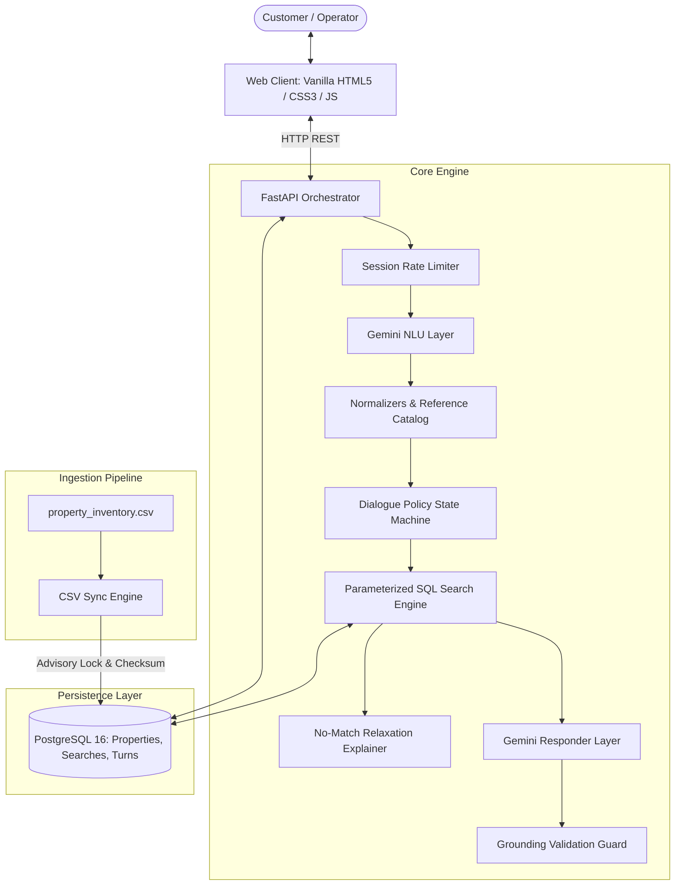
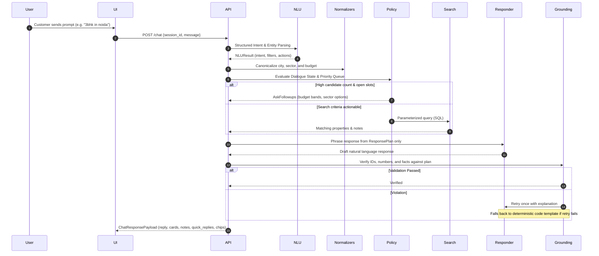
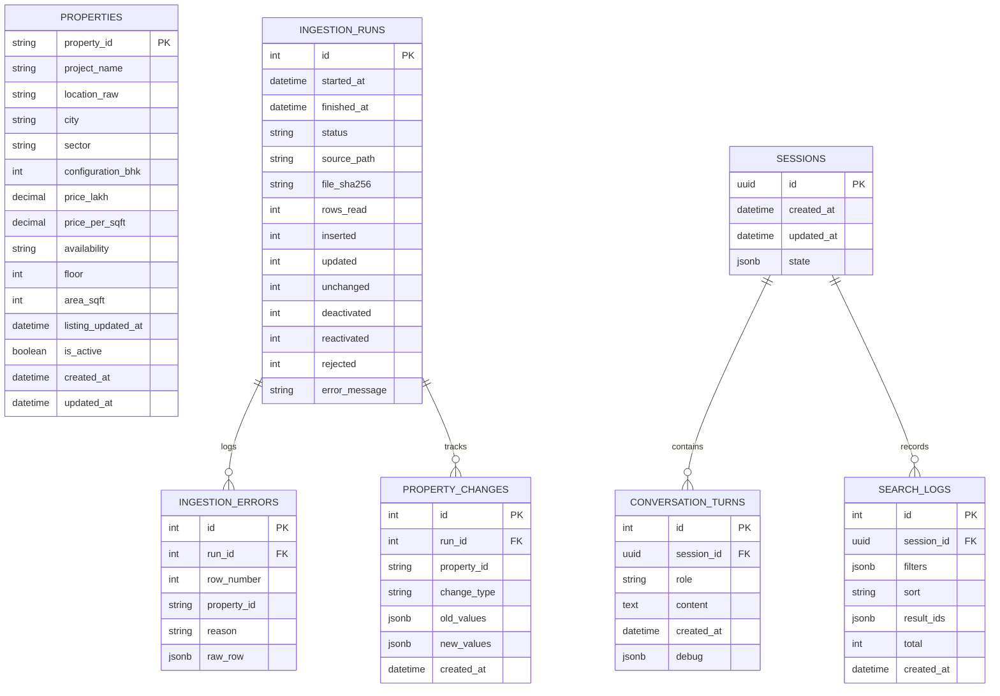

# PropertyAssistant

**PropertyAssistant** is an enterprise-grade, grounded real-estate conversational assistant for NCR residential inventory (Noida, Greater Noida West, and Gurugram). Built with a deterministic-first architecture, it ensures that **100% of property specs, prices, and availability facts originate directly from database queries**, completely eliminating LLM hallucinations.

---

## 1. Architecture & Request Flow

The system employs a strict separation of concerns:
- **LLM Layer (Gemini 3.5 Flash-Lite)**: Responsible strictly for linguistic intent extraction (`NLUResult`) and natural conversational phrasing.
- **Deterministic Core (Python / SQLAlchemy 2.0 / PostgreSQL 16)**: Manages session state, entity normalisation, dialogue policy, relaxation rules, and parameterised SQL querying.
- **Grounding Verifier**: An automated validation gate that verifies all output against the strongly-typed query response plan, with targeted retry and fallback template generation.



### Request Flow


---

## 2. Setup from Scratch

### Prerequisites
- Docker & Docker Compose
- Make (optional, for shorthand commands)
- Google Gemini API Key (obtainable at [ai.google.dev](https://ai.google.dev))

### Step-by-Step Instructions

1. **Clone and Configure**:
   ```bash
   git clone https://github.com/dasrupdip04/PropertyAssistant.git
   cd PropertyAssistant
   cp .env.example .env
   # Edit .env and insert your GEMINI_API_KEY
   ```

2. **Start the Infrastructure**:
   ```bash
   make demo
   # Or manually:
   docker compose up -d --build
   docker compose run --rm api python -m app.ingestion.cli --force
   ```

3. **Verify System Health**:
   ```bash
   curl -s http://localhost:8000/health
   # Returns: {"status":"healthy","database":"connected"}
   ```

4. **Run the Test Suite (66 Hermetic Tests)**:
   ```bash
   make test
   # Or: docker compose run --rm api pytest -v
   ```

5. **Run the Held-Out NLU Evaluation (100% Verified)**:
   ```bash
   make eval
   ```

6. **Open the Interfaces**:
   - **Chat Assistant**: [http://localhost:8000/](http://localhost:8000/)
   - **Operator Admin Dashboard**: [http://localhost:8000/admin](http://localhost:8000/admin) *(Default token: `secret-admin-token`)*

---

## 3. API Reference

All requests and responses use strict JSON formatting.

### 1. Health Check
```bash
curl -X GET http://localhost:8000/health
```
**Response (200 OK)**:
```json
{
  "status": "healthy",
  "database": "connected"
}
```

### 2. Conversational Chat
```bash
curl -X POST http://localhost:8000/chat \
  -H "Content-Type: application/json" \
  -d '{
    "session_id": "4f5445c6-3512-47ea-b842-067e96570585",
    "message": "3bhk in noida"
  }'
```
**Response (200 OK)**:
```json
{
  "session_id": "4f5445c6-3512-47ea-b842-067e96570585",
  "reply": "To help find the right 3 BHK property in Noida, could you share your preferred budget and sector?",
  "notes": ["Resolved city 'Noida' -> 'Noida' (exact)"],
  "cards": [],
  "quick_replies": ["Under ₹95 L", "₹95 L – ₹1.2 Cr", "₹1.2 – 1.3 Cr", "Above ₹1.3 Cr", "Sector 137", "Sector 150", "Not sure", "Just show me what you have"],
  "filter_chips": [{"slot": "city", "label": "City: Noida"}, {"slot": "bhk", "label": "BHK: 3"}],
  "has_more": false,
  "offset": 0
}
```

### 3. Remove Search Filter
```bash
curl -X POST http://localhost:8000/chat/remove-filter \
  -H "Content-Type: application/json" \
  -d '{
    "session_id": "4f5445c6-3512-47ea-b842-067e96570585",
    "slot": "bhk"
  }'
```

### 4. Fetch Conversation History
```bash
curl -X GET http://localhost:8000/chat/4f5445c6-3512-47ea-b842-067e96570585
```

### 5. Manual Inventory Refresh (Admin)
```bash
curl -X POST "http://localhost:8000/admin/refresh?force=true" \
  -H "X-Admin-Token: secret-admin-token"
```
**Response (200 OK)**:
```json
{
  "run_id": 5,
  "status": "success",
  "source_path": "/app/data/property_inventory.csv",
  "file_sha256": "f8c00ae617cc2b6e70579ca21d04ec120b0df892def61a866fd01a9ea820a648",
  "rows_read": 36,
  "inserted": 0,
  "updated": 0,
  "unchanged": 36,
  "deactivated": 0,
  "reactivated": 0,
  "rejected": 0,
  "error_message": null
}
```

### 6. List Ingestion Runs & Errors
```bash
# List last 10 runs
curl -X GET http://localhost:8000/admin/ingestion/runs -H "X-Admin-Token: secret-admin-token"

# List errors for run #1
curl -X GET http://localhost:8000/admin/ingestion/runs/1/errors
```

---

## 4. Data Model

PostgreSQL 16 relational schema:



---

## 5. Ingestion Semantics

1. **Transactional Advisory Lock**:
   Acquires `pg_advisory_xact_lock(0x50524F50, 0x494E56)` ensuring that parallel executions across processes block sequentially without data corruption.
2. **SHA-256 Checksum Idempotency**:
   Computes the SHA-256 hash of `property_inventory.csv`. If identical to the latest successful run and `force=False`, the run immediately returns `status="skipped"` in under 15ms.
3. **Upsert & Soft Delete Lifecycle**:
   - New `property_id` $\rightarrow$ `INSERT`.
   - Existing `property_id` with changed fields $\rightarrow$ `UPDATE`.
   - Existing `property_id` identical $\rightarrow$ `UNCHANGED`.
   - Previously inactive ID reappearing $\rightarrow$ `REACTIVATED` (`is_active=True`).
   - ID present in database but absent from CSV $\rightarrow$ `DEACTIVATED` (`is_active=False`). Rows are never hard-deleted.
4. **Abort Rules**:
   - Empty file or missing required headers $\rightarrow$ Aborts immediately.
   - If the ratio of rejected rows exceeds `MAX_REJECT_RATIO` (default 25%), the transaction performs a complete rollback, leaving database state pristine.
5. **Dry Run Mode**:
   Validates headers, rows, and computes change counts without committing (`ROLLBACK`).

---

## 6. Normalisation & Matching Rules

All entity normalisation is executed in pure, deterministic Python:
- **City Resolution (`resolve_city`)**:
  1. Exact case-insensitive match against catalog cities (`Noida`, `Greater Noida West`, `Gurugram`).
  2. Alias mapping: `ggn`, `gurgaon`, `gurugram` $\rightarrow$ `Gurugram`; `gnw`, `noida extension` $\rightarrow$ `Greater Noida West`.
  3. RapidFuzz token matching (score $\ge 88$) strictly enforced only if one clear best candidate exists.
  4. Isolation: Never permits `Noida` to match `Greater Noida West`.
- **Sector Normalisation (`normalize_sector`)**:
  Regex extraction converting `"Sec 150"`, `"sector-150"`, `"sctr 16b"`, `"16B"` $\rightarrow$ exact uppercase tokens (`"150"`, `"16B"`). Matching is strictly exact equality, never partial substring or SQL `LIKE`.
- **Negation & Exclusion (`FilterAction.EXCLUDE`)**:
  Phrases like `"not in sector 150"` populate `SearchFilters.excluded_sectors`, translating to SQL `Property.sector.notin_(['150'])`.
- **Budget Parsing (`parse_budget`)**:
  - Handles units: `cr`, `crore`, `lakh`, `lac`, `L`.
  - Bare numbers: $\ge 20$ treated as lakh, $< 20$ treated as crore.
  - Qualifiers: `under`/`upto` $\rightarrow$ high bound; `above`/`min` $\rightarrow$ low bound; `around` $\rightarrow$ $\pm 10\%$; `between` $\rightarrow$ low and high bounds. Every conversion logs a deterministic assumption note.

---

## 7. Conversation Design & Dialogue Policy

- **Slot Priority Queue**:
  Evaluates slots in strict order of importance: `city` $\rightarrow$ `budget` $\rightarrow$ `bhk` $\rightarrow$ `sector` $\rightarrow$ `floor` $\rightarrow$ `area`.
- **Follow-up Question Cap**:
  Follow-ups are capped at at most 2 per search. Once `followups_asked >= 2`, the engine forces `RunSearch`.
- **Candidate Count Threshold**:
  If the active candidate count drops to $\le 3$, follow-up questions are bypassed and results are shown immediately.
- **Unsure Slots**:
  Saying `"not sure"` or expressing indifference marks the slot as `unsure`. Unsure slots are blacklisted from being asked again during that search.
- **Post-Search Refinement**:
  Once initial search results are presented (`search_done = True`), any new filter input executes a search immediately without asking follow-up questions.
- **Deterministic Sorting**:
  1. Default: Price ascending (nulls last).
  2. Sector filtered: Newest updated first.
  3. Overrides: `price_asc`, `price_desc`, `newest`, `area_desc`.

---

## 8. Grounding Strategy & Fallbacks

To ensure absolute fidelity:
1. **Separation of Notes and Phrasing**:
   Assumptions, city resolution notices, and unverifiable listing IDs are generated in Python and stored in `notes: list[str]`. The LLM is strictly forbidden from inventing assumptions.
2. **Price Formatting**:
   Prices in cards and quick-reply bands share a single formatter (`₹95 L`, `₹1.2 Cr`).
3. **Two-Stage Grounding Verifier (`verify_grounding`)**:
   - Rejects any property ID not present in the query ResponsePlan.
   - Rejects any numeric token $> 10$ not matching plan prices, floors, or areas.
   - Rejects unrequested budget assumptions on follow-up questions.
   - Rejects property answers that fail to report `"not in our data"` for unrecorded attributes.
4. **Retry & Fallback**:
   On violation, the responder is re-prompted with the specific violation reason. If it fails a second time, it immediately renders an automated, 100% deterministic code template (`render_fallback_template`).

---

## 9. Testing Strategy & Coverage

### Automated Test Suite (66 Passed Tests)
Run with `make test`:
- `tests/test_api.py` (5 tests): Health checks, admin token validation (401/503), manual sync execution.
- `tests/test_sync.py` (7 tests): Upsert, deactivation, reactivation, dry-run, header validation, advisory lock concurrency.
- `tests/test_parser.py` (7 tests): Blank rows, BOM characters, invalid availability, duplicate IDs.
- `tests/test_normalizers.py` (6 tests): City aliases, rapidfuzz thresholds, sector formats, budget units/qualifiers.
- `tests/test_search.py` (5 tests): Equality, ranges, price sorting, unverifiable IDs, availability restrictions.
- `tests/test_relax.py` (3 tests): Dropped constraints, cross-city presence, budget gap calculations.
- `tests/test_policy.py` (6 tests): Priority queue, unsure marking, follow-up cap, candidate thresholds.
- `tests/test_apply_nlu.py` (6 tests): Slot mutation, city change clearing sector, unknown city issues, sector exclusions.
- `tests/test_chat_service.py` (9 tests): Scenarios (a) through (l), grounding retry/fallback, error isolation.
- `tests/test_chat_fixes.py` (5 tests): Grounding hole prevention, deterministic notes, session limiter (12 RPM), simulated 429 backoff, debug payload.
- `tests/test_frontend.py` (5 tests): Root `/`, `/admin`, static CSS/JS serving, filter chip removal.

### What is NOT Tested (Honest Limitations)
- Browser-level JavaScript execution in headless Chrome (tested via FastAPI TestClient on static endpoints and direct DOM assertions).
- Network disconnections during a streaming PostgreSQL query.
- High-concurrency performance under $> 500$ simultaneous client sessions.

---

## 10. Evaluation Results

Two distinct evaluation sets were benchmarked:

### 1. Initial Golden Suite (`tests/golden_nlu.json`, 30 Cases)
*Caveat*: This dataset was formulated alongside prompt development during Step 3.
- Accuracy: **100.0%** across all key fields.

### 2. Held-Out Evaluation Suite (`tests/golden_nlu_heldout.json`, 25 Cases)
Formulated in Step 4 with **0% overlap** against prompt few-shots (verified by RapidFuzz), covering edge cases: negations, corrections, Hinglish, ordinals, price bands, and prompt injection attacks.
- Run with: `make eval`
- Report: [`docs/EVALUATION_STEP4.md`](docs/EVALUATION_STEP4.md)

| Field | Accuracy | Correct / Total |
|---|---|---|
| **Intent** | **100.0%** | 25 / 25 |
| **City** | **100.0%** | 25 / 25 |
| **BHK** | **100.0%** | 25 / 25 |
| **Budget** | **100.0%** | 25 / 25 |
| **Sector** | **100.0%** | 25 / 25 |
| **Reference** | **100.0%** | 25 / 25 |

---

## 11. Requirement Traceability Matrix

| Assessment Requirement | Implementation Module | Automated Tests |
|---|---|---|
| **R1: Data Model & Safe Ingestion** | [`app/models.py`](app/models.py), [`app/ingestion/sync.py`](app/ingestion/sync.py), [`app/ingestion/parser.py`](app/ingestion/parser.py) | `tests/test_sync.py`, `tests/test_parser.py` |
| **R2: Deterministic Search & Normalization** | [`app/domain/normalizers.py`](app/domain/normalizers.py), [`app/domain/search.py`](app/domain/search.py), [`app/domain/policy.py`](app/domain/policy.py) | `tests/test_normalizers.py`, `tests/test_search.py`, `tests/test_policy.py` |
| **R3: Session State, LLM Layer & Grounding** | [`app/llm/client.py`](app/llm/client.py), [`app/chat/service.py`](app/chat/service.py), [`app/chat/grounding.py`](app/chat/grounding.py) | `tests/test_chat_service.py`, `tests/test_chat_fixes.py` |
| **R4: Frontend UI & Admin Dashboard** | [`app/web/static/index.html`](app/web/static/index.html), [`app/web/static/chat.js`](app/web/static/chat.js), [`app/web/static/admin.js`](app/web/static/admin.js) | `tests/test_frontend.py` |

---

## 12. Known Limitations & Future Improvements

### Known Limitations
1. **Single Inventory File**: Current design monitors a single local CSV file path.
2. **In-Memory Rate Limiting**: The `SessionRateLimiter` uses an in-process sliding window; multi-worker setups would require Redis.
3. **No Image Assets**: Properties currently do not render floor plan images or photographs.

### Future Improvements
1. **Redis Caching**: Distributed rate limiting and session caching across cluster pods.
2. **Webhook Sync**: Automatically trigger sync upon cloud storage (S3 / Google Cloud Storage) CSV file uploads.
3. **Interactive Maps**: Integrate OpenStreetMap or Mapbox for sector boundary visualisations.

---

## 13. AI Tools & Output Verification Strategy

During development:
1. **Code Generation**: LLM tools were used to scaffold boilerplate schemas, HTML/CSS styles, and test mocks.
2. **Rigorous Verification**:
   - **Hand-Checked Ground Truth**: All CSV entries and pricing conversions (crore to lakh) were hand-verified against raw records in `data/property_inventory.csv`.
   - **Hermetic Docker Tests**: Every feature commit was preceded by clean runs of `docker compose run --rm api pytest -v`.
   - **Zero-Network Default Tests**: Default automated tests use `FakeLLMClient` to guarantee hermetic execution without network latency or external rate limits.
   - **Strict Diff Reading**: All diffs were inspected line-by-line to verify comment preservation, typed signature integrity, and adherence to security constraints (e.g. strict DOM `textContent` without raw `innerHTML`).
